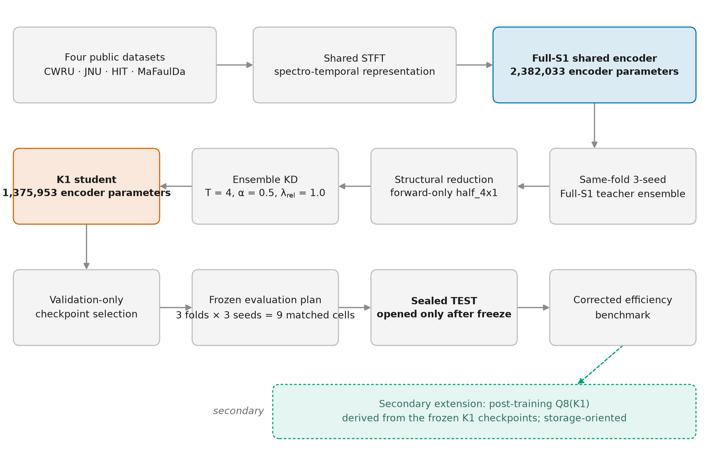

# RotorMamba / Lightweight PC-STE: Compressing a Mamba Fault-Diagnosis Model for Efficient Deployment

**Predictive maintenance for rotating machinery.** This project detects bearing and machine faults from raw vibration signals with one self-supervised encoder shared across four industrial datasets, then compresses that encoder so it runs roughly twice as fast on CPU and GPU, *without losing accuracy*.

<p align="center">
  
</p>

## At a glance

| | Full model (teacher) | Lightweight model (K1) | Change |
|---|---:|---:|---:|
| Macro-F1, average over 4 datasets | 93.46% | **95.53%** | +2.07 points |
| Encoder parameters | 2.38 M | 1.38 M | −42% |
| Compute per 1-second vibration window | 2.61 GFLOP | 1.42 GFLOP | −45% |
| CPU latency (batch 1, model only) | 54.7 ms | 28.6 ms | 1.92× faster |
| GPU throughput (batch 32) | 393 windows/s | 786 windows/s | 2.0× |
| Stored size after INT8 quantisation | 9.1 MiB (FP32) | **1.53 MiB** | 6× smaller |

The smaller model is *more* accurate than the model it was distilled from in 8 of 9 matched runs, and it passed a pre-registered non-inferiority test (exact sign-flip p = 0.002).

## What is in this repository

- **PC-STE encoder.** A physics-informed encoder for vibration signals: signals are turned into frequency-band × time patches, mixed by a frequency-aware gated mixer, and modelled by bidirectional Mamba (selective state-space) layers. It is pre-trained with masked-reconstruction self-supervision, then fine-tuned with one classification head per dataset.
- **Structural compression and distillation.** The lightweight K1 student keeps the four temporal stages but drops the reverse scan path, and is trained by knowledge distillation from an ensemble of three seeded teachers.
- **Deployment benchmarking.** CPU/GPU latency, throughput, memory and FLOPs, measured with a fixed, documented protocol, plus weight-only INT8 post-training quantisation.
- **Research rigour.** Leakage-safe fold splits, validation-only checkpoint selection, a test set sealed until every checkpoint and analysis plan was frozen and hash-pinned, and SHA-256 manifests for every frozen artifact.

**Datasets:** CWRU, JNU, HIT and MaFaulDa (public benchmarks; not redistributed, see `docs/DATASETS.md`).
**Stack:** Python, PyTorch, Mamba / selective state-space models, NumPy, SciPy, scikit-learn, pytest.

## Getting started

```bash
git clone https://github.com/mohammadabdalaziz241/lightweight-pcste.git
cd lightweight-pcste
python -m venv .venv && source .venv/bin/activate
pip install -r requirements_frozen.txt          # exact environment (or requirements.txt for floors)
sha256sum -c FROZEN_ARTIFACT_HASHES.sha256       # verify every frozen artifact
pytest tests/                                    # artifact and import checks (CPU)
```

Training and test inference need a CUDA GPU and the four datasets placed under `data/`; the full procedure is in [`docs/REPRODUCIBILITY.md`](docs/REPRODUCIBILITY.md). Model checkpoints are not stored in Git.

| To understand | Start here |
|---|---|
| The encoder architecture | [`src/methodology_v2/encoder/pcste.py`](src/methodology_v2/encoder/pcste.py) · [`docs/MODEL.md`](docs/MODEL.md) |
| Distillation and compression | [`src/methodology_v2/compression/`](src/methodology_v2/compression/) · [`scripts/train_k1/02_k1_production.py`](scripts/train_k1/02_k1_production.py) |
| Quantisation | [`src/methodology_v2/compression/quantization.py`](src/methodology_v2/compression/quantization.py) |
| Evaluation protocol and statistics | [`docs/EXPERIMENT_PROTOCOL.md`](docs/EXPERIMENT_PROTOCOL.md) · [`docs/RESULTS.md`](docs/RESULTS.md) |

---

# Full research record

The sections below are the detailed, publication-grade record. In this notation, **Full-S1** is the full teacher model, **K1** is the lightweight student, **Q8(K1)** is its INT8-quantised form, **GF1–GF3** are the three global folds, and **Macro-4** is the equal-weight average over the four datasets.

The scientific workflow is `Full PC-STE / S1 teacher ensemble -> knowledge-distilled K1 encoder -> deployment and efficiency evaluation`. K1 uses **one shared 1,375,953-parameter encoder** across CWRU, JNU, HIT and MaFaulDa, with dataset-specific classification heads. The matched design covers three global folds × three random seeds (nine matched cells, eighteen checkpoints).
## Status

- **K1 training is complete: 9/9 cells** (GF1 3/3, GF2 3/3, GF3 3/3), frozen in `configs/lightweight_k1/K1_9_CELL_FREEZE_MANIFEST.md` (SHA256 `a9e5fb49a1f38a7d6e2649ff8d155cf619cd55572bf7238b06a1fcb120d64a8b`).
- **The final sealed publication TEST is complete** under protocol `lightweight_pcste_final_test_v1`, status `PUBLICATION_FINAL_SEALED_TEST_COMPLETE`.
- Checkpoint selection used **validation only** (maximum validation Macro-Domain F1, strict improvement, earliest-epoch tie retention, no early stopping). No TEST metric entered training or selection.
- **TEST remained sealed** until all eighteen checkpoints *and* the publication evaluation plan were frozen and externally hash-pinned. TEST was then executed exactly once under that frozen plan.
- **Efficiency benchmarking is complete** under `lightweight_pcste_efficiency_v1` (see below).
- **A secondary Q8 deployment extension is complete** under `lightweight_pcste_q8_v1`. It was frozen *after* the primary study and evaluated afterwards; it is **not** part of the original sealed Full-S1-vs-K1 comparison.

## Design

| Property | Value |
|---|---|
| Datasets | CWRU, JNU, HIT, MaFaulDa |
| Folds x seeds | 3 global folds x seeds 42, 1337, 2026 = 9 matched cells |
| Teacher / base | Full-S1 (full PC-STE v2 S1) |
| Student | K1, `half_4x1`, 1,375,953 encoder parameters, shared encoder + per-dataset heads |
| KD temperature | 4 |
| KD alpha | 0.5 |
| Relational weight | 1.0 |
| Teacher aggregation | `mean_prob_at_T` (same-fold three-seed S1 ensemble) |
| KL direction | teacher \|\| student |
| Epochs per cell | 50 |
| Checkpoint selection | validation-only max Macro-Domain F1 |
| Primary endpoint | Macro-4 Macro-F1 (equal weight over the four datasets) |
| Non-inferiority margin | -0.02 (frozen before TEST) |

## Final sealed TEST results

Nine matched cells, paired within (fold, seed). Mean +/- sample SD (`ddof=1`).

### Macro-4 Macro-F1 (primary endpoint)

| Metric | Full-S1 | K1 | Paired delta (K1 - Full-S1) | K1 wins/ties/losses |
|---|---:|---:|---:|---:|
| Macro-4 Macro-F1 | 0.934644 +/- 0.023258 | 0.955334 +/- 0.018393 | +0.020691 +/- 0.013509 | 8 / 0 / 1 |
| Macro-4 Macro-AUC | 0.991793 +/- 0.008102 | 0.996398 +/- 0.002367 | +0.004606 +/- 0.006794 | 8 / 0 / 1 |

### Per-dataset Macro-F1

| Dataset | Full-S1 | K1 | Paired delta |
|---|---:|---:|---:|
| CWRU | 0.854747 +/- 0.083579 | 0.918945 +/- 0.073432 | +0.064198 +/- 0.044152 |
| JNU | 0.971429 +/- 0.042857 | 0.980952 +/- 0.037796 | +0.009524 +/- 0.028571 |
| HIT | 0.991039 +/- 0.017798 | 0.988728 +/- 0.016133 | -0.002311 +/- 0.007427 |
| MaFaulDa | 0.921360 +/- 0.016432 | 0.932712 +/- 0.017321 | +0.011352 +/- 0.019450 |

### Per-dataset Macro-AUC

| Dataset | Full-S1 | K1 | Paired delta |
|---|---:|---:|---:|
| CWRU | 0.974093 +/- 0.033643 | 0.990379 +/- 0.009921 | +0.016286 +/- 0.027983 |
| JNU | 0.999559 +/- 0.001323 | 1.000000 +/- 0.000000 | +0.000441 +/- 0.001323 |
| HIT | 0.999969 +/- 0.000094 | 0.999602 +/- 0.001082 | -0.000366 +/- 0.001095 |
| MaFaulDa | 0.993549 +/- 0.006247 | 0.995611 +/- 0.004732 | +0.002062 +/- 0.003131 |

### Predefined confirmatory result

The single pre-registered confirmatory contrast is non-inferiority of K1 against Full-S1 on Macro-4 Macro-F1 at the frozen margin `-0.02`, tested by exact sign-flip enumeration over the nine paired differences (all 512 sign patterns).

- **Non-inferiority criterion: SATISFIED.** Exact one-sided sign-flip p = `0.001953125`.
- The hierarchically gated superiority test, reported only because the non-inferiority gate passed, gives exact two-sided sign-flip p = `0.0078125`.

These are exact permutation p-values over nine matched cells, not large-sample tests. The point estimate favours K1, but the study was designed and powered as a non-inferiority comparison; the superiority result is a gated secondary observation from a nine-cell paired design and should be read as supportive rather than definitive. One cell (fold 1, seed 1337) favours Full-S1, and HIT shows a small negative mean delta on both metrics.

Authoritative artifacts: `results/final_test/publication_final_test_v1/`.

## Efficiency and deployment

Fresh publication-grade efficiency measurements were taken under `lightweight_pcste_efficiency_v1` on a single idle RTX 4000 Ada host, using the deterministically fixed **GF1 / seed 42** checkpoint pair (rule: lowest fold, then lowest seed) and deterministic VALIDATION inputs. No dissertation-era efficiency number is reused.

| Metric | Full-S1 | K1 | Reduction / speed-up |
|---|---:|---:|---:|
| Encoder parameters | 2,382,033 | 1,375,953 | 42.24% (1.73×) |
| Complete model parameters | 2,385,893 | 1,379,813 | 42.17% |
| FP32 state_dict size | 9.135 MiB | 5.286 MiB | 42.14% |
| Macro-4 FLOPs / 1 s window | 2.6067 GFLOP | 1.4236 GFLOP | 45.38% (1.83×) |
| CPU batch-1 model-only latency | 54.709 ms | 28.560 ms | 47.80% (1.92×) |
| CPU batch-1 end-to-end latency | 55.699 ms | 29.725 ms | 46.63% (1.87×) |
| GPU batch-1 model-only latency | 7.711 ms | 4.164 ms | 46.00% (1.85×) |
| GPU batch-1 end-to-end latency | 9.577 ms | 5.864 ms | 38.76% (1.63×) |
| GPU batch-32 throughput | 392.9 windows/s | 785.5 windows/s | 2.00× |
| CPU batch-32 throughput | 13.84 windows/s | 26.27 windows/s | 1.90× |
| GPU peak memory (batch 1) | 29.466 MiB | 24.823 MiB | 15.76% |

Latency figures are batch-1 medians aggregated as the equal-domain mean of the four per-dataset medians (CPU single-thread; 100/200 warm-up and 1000 timed iterations per cell, ABAB-interleaved). Model-only and end-to-end scopes are reported separately and never mixed; disk I/O is excluded from both. FLOPs are the explicit sum of a profiler dense term and an analytic selective-scan term — never a profiler count alone.

**Timing provenance.** The latency and throughput rows come from `lightweight_pcste_efficiency_latency_correction_v1`, which is the authoritative timing result. The original `lightweight_pcste_efficiency_v1` remains frozen for provenance, but its latency/throughput code path never entered `torch.inference_mode()` despite its plan stating that mode, so its absolute milliseconds were inflated (~40% on CPU) and its CPU speed-ups were overstated by ~13% (2.21× → 1.92× model-only). Its parameter, size, FLOP and GPU-memory rows were unaffected and are reused unchanged. Every timed forward in the corrected run asserts `torch.is_inference_mode_enabled()` — 584 assertions, 0 violations. See [`benchmarks/efficiency_latency_correction_v1/LATENCY_CORRECTION_REPORT.md`](benchmarks/efficiency_latency_correction_v1/LATENCY_CORRECTION_REPORT.md).

**Caveat carried on every timing figure:** all measurements use the pure-PyTorch reference selective scan, as fused Mamba kernels are unavailable on this stack. Absolute latency, and possibly the Full-S1 / K1 ratio, would differ with fused kernels. Results are from one representative cell on one host.

Full detail: [`benchmarks/efficiency_v1/EFFICIENCY_FINAL_REPORT.md`](benchmarks/efficiency_v1/EFFICIENCY_FINAL_REPORT.md).

## Secondary extension — Q8(K1) deployment quantization

> **Stage separation.** Everything above is the **primary study**: a pre-registered, sealed-TEST, confirmatory non-inferiority comparison of Full-S1 vs K1 at margin −0.02. What follows is a **secondary extension**, frozen only after that study and its efficiency benchmark were complete. Q8 was never part of the sealed comparison, and nothing here changes the primary claim.

Q8 is not a trained model. It is derived deterministically from each already-frozen K1 checkpoint by the historical Part-6 recipe: per-output-channel symmetric int8 weights on 23 allowlisted `nn.Linear` modules, **no calibration**, with `dt_proj`, `A_log`, `D`, `conv1d`, all LayerNorms, `stem.conv` and the selective-scan path retained in FP32.

| Metric | K1 FP32 | Q8(K1) | Change |
|---|---:|---:|---:|
| Macro-4 Macro-F1 | 0.955334 ± 0.018393 | 0.955334 ± 0.018405 | −0.0000009 ± 0.0001101 |
| Macro-4 Macro-AUC | 0.996398 ± 0.002367 | 0.996395 ± 0.002376 | −0.0000031 ± 0.0000156 |
| Stored model size | 5.285 MiB | **1.526 MiB** | −71.12% (3.46×) |
| CPU batch-1 latency (model-only) | 31.046 ms | 28.647 ms | 1.084× |
| CPU batch-32 throughput | 26.56 win/s | 27.34 win/s | 1.029× |
| Parameters | 1,379,813 | 1,379,813 | unchanged |

Six of the nine cells are bit-identical to K1. The **historically pre-defined** non-inferiority test (margin −0.01, from `quantization_spec.yaml` and `NI_MARGIN_PTQ`; exact one-sided sign-flip on margin-shifted deltas over the nine fold×seed cells) is **SATISFIED**, exact p = `0.001953125`. Holm adjustment from the historical 3-hypothesis family is **not** applied — that family is not executable — so this is a standalone secondary contrast with no family-wise error control.

Relative to Full-S1, Q8 is **83.29% smaller (5.99×)**.

**Three limits stated plainly:**

1. **No true INT8 GPU path exists** in the preserved implementation — `quantized::linear_dynamic` has no CUDA backend, and the accuracy representation dequantises to FP32. No GPU latency or GPU memory figure is reported for Q8.
2. **The CPU gain is modest** (≈8% at batch 1), consistent with the frozen historical note that weight-only int8 cannot speed the FP32 sequential scan that dominates runtime.
3. **The evaluated representation and the deployed CPU artifact are not numerically identical.** TEST accuracy is evaluated on the weight-only `sim` representation; the deployed `cpu_dynamic` artifact also quantizes activations and agrees with `sim` on 98.63% of validation windows (95.0% on MaFaulDa). The non-inferiority result covers `sim`, **not** `cpu_dynamic`.

Full detail: [`benchmarks/q8_v1/Q8_FINAL_REPORT.md`](benchmarks/q8_v1/Q8_FINAL_REPORT.md).

## Layout

| Path | Contents |
|---|---|
| `src/` | Historical scientific implementation, import layout preserved |
| `scripts/train_ssl/`, `scripts/train_s1/` | Exact SSL and Full-S1 executors |
| `scripts/train_k1/02_k1_production.py` | K1 production executor |
| `scripts/evaluate/` | Historical evaluator and the frozen publication TEST driver |
| `configs/final_s1/` | Frozen Full-S1 specification, statistical plan, selected checkpoints |
| `configs/lightweight_k1/` | Frozen K1 protocol, registered cells, freeze manifest |
| `configs/lightweight_k1/final_test_v1/` | Publication TEST pre-registration (plan, model table, barrier, driver) |
| `protocols/` | Frozen dataset and split manifests |
| `results/lightweight_k1/` | Per-cell validation-stage summaries (9 cells, no checkpoints) |
| `results/final_test/publication_final_test_v1/` | Sealed final TEST results and per-model class-level reports |
| `benchmarks/efficiency_v1/` | Frozen efficiency benchmark: plan, driver, results, final report |
| `benchmarks/efficiency_latency_correction_v1/` | **Authoritative** corrected latency/throughput timings |
| `benchmarks/q8_v1/` | Secondary Q8 extension: plan, barrier, driver, results, final report |
| `docs/` | Protocol, reproducibility, results, artifact policy, inventory |
| `FROZEN_ARTIFACT_HASHES.sha256` | SHA256 manifest of every frozen artifact tracked here |

Verify frozen artifacts with `sha256sum -c FROZEN_ARTIFACT_HASHES.sha256`.

See `docs/EXPERIMENT_PROTOCOL.md`, `docs/RESULTS.md`, `docs/REPRODUCIBILITY.md`, and `docs/ARTIFACTS.md` before using or extending this repository.
